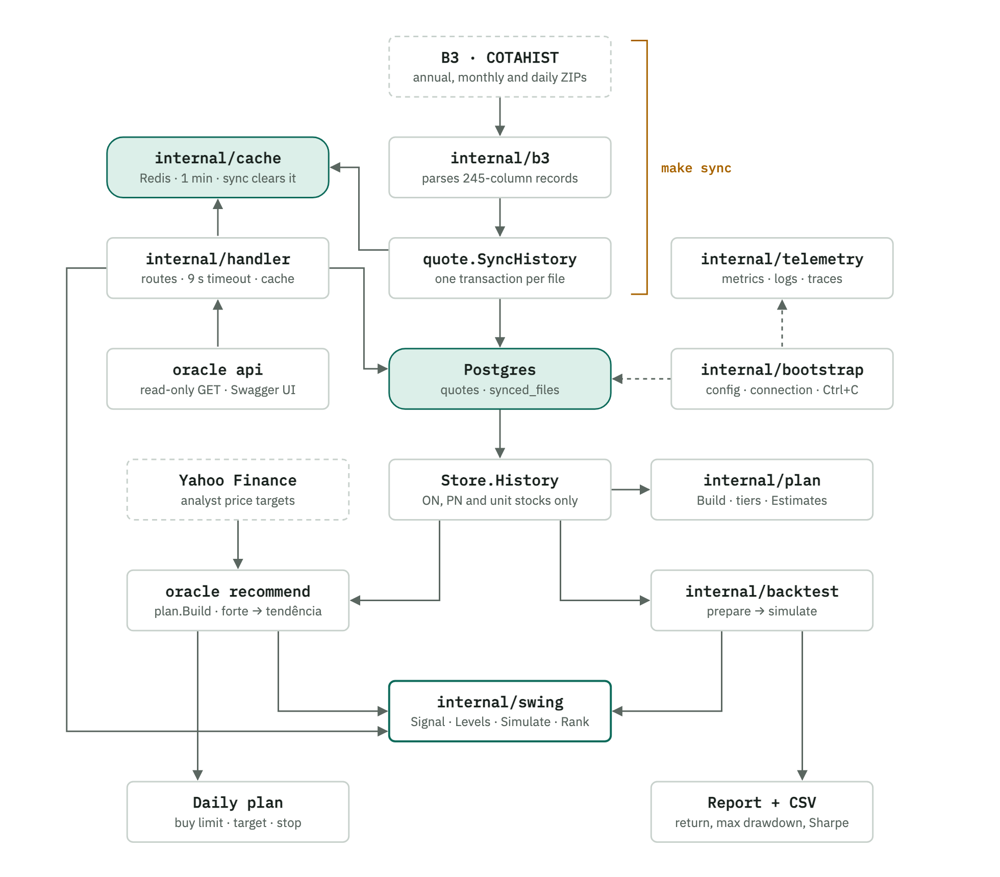
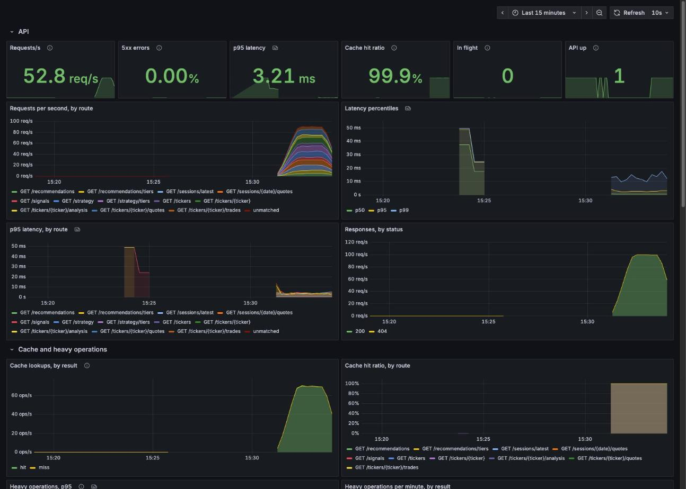
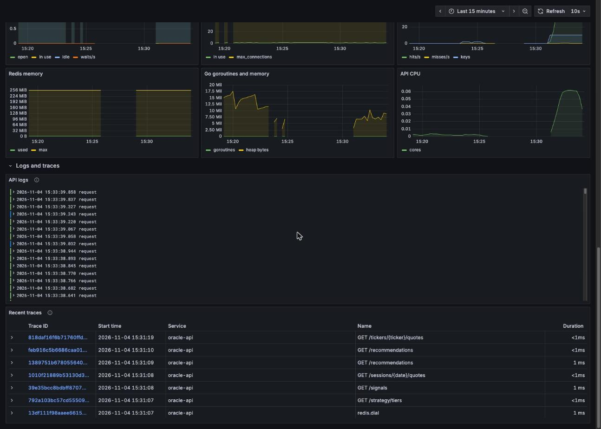

# oracle

[](https://github.com/piovani/oracle/actions/workflows/ci.yml)
[](go.mod)
[](docker-compose.yml)
[](#tests)
[](docs/swagger.yaml)
[](docs/postman-collection.json)

B3 (Brazilian stock exchange) quote history stored in Postgres, plus a command that builds the day's trading plan from it.

<p align="center">
  <a href="docs/flow.html">
    <picture>
      <source media="(prefers-color-scheme: dark)" srcset="docs/flow-dark.png">
      
    </picture>
  </a>
</p>

For the interactive version, open [`docs/flow.html`](docs/flow.html) in a browser. It shows the path of each command (`sync`, `recommend`, `backtest`, `api`), one trade session by session, and the rules the code must not break.

## Setup

Requires Go 1.27.3 and Docker.

```
docker compose up -d
cp .env.example .env
make sync
```

`make sync` downloads B3's COTAHIST files and stores the cash market quotes (standard lot). Use `make sync SINCE=2020` to limit the first year.

The sync is incremental: every downloaded file is recorded in the database and never downloaded again. Run it every day after the close to bring in the latest session.

### Database schema

The schema comes from numbered SQL files in [`internal/quote/migrations`](internal/quote/migrations), embedded in the binary. `make sync` applies the ones the database does not have yet (recorded in the `schema_migrations` table), so an empty database is built from scratch by the first sync, and a database that already has the tables is adopted as it is.

To change the schema, or add an index, create the next file, for example `0003_index_quotes_spec.sql`, written to be idempotent (`CREATE INDEX IF NOT EXISTS ...`). Never edit a file that already ran: add a new one. Everything runs in one transaction, so `CREATE INDEX CONCURRENTLY` does not fit there.

### Configuration

Everything comes from `.env` (or environment variables). The defaults match `docker-compose.yml`, so nothing needs to change to run locally.

| Variable | Default |
|---|---|
| `DB_HOST`, `DB_PORT` | `localhost`, `5432` |
| `DB_USER`, `DB_PASSWORD`, `DB_NAME` | `oracle` |
| `DB_SSLMODE` | `disable` |
| `REDIS_ADDR` | `localhost:6379` |
| `REDIS_PASSWORD` | — |
| `REDIS_DB` | `0` |
| `REDIS_PREFIX` | `oracle:cache:` (starts every key, so environments can share one Redis) |
| `PORT` | `8080` (used only by the API) |
| `METRICS_PORT` | `9100` (where Prometheus scrapes `/metrics`; used only by the API) |
| `LOG_FORMAT` | `text` (`json` for JSON lines on stderr) |
| `OTEL_EXPORTER_OTLP_TRACES_ENDPOINT`, `OTEL_EXPORTER_OTLP_LOGS_ENDPOINT` | unset: nothing is sent (see [Monitoring](#monitoring)) |
| `ENV` | `development` |

## Trading plan

```
make sync
make recommend
make recommend CAPITAL=2000 TOP=5 RISK=2
```

| Variable | Default | Meaning |
|---|---|---|
| `CAPITAL` | 500 | available capital, in BRL |
| `TOP` | 5 | maximum number of stocks in the plan |
| `RISK` | 2 | maximum loss per trade, as % of capital |
| `FILL` | — | `FILL=1` fills the list with weaker signals |

The binary also takes `-years` (years of history, default 3) and `-no-estimates` (ignores analyst estimates).

For each stock, the output shows: company name, signal strength, quantity, buy order price, sell price (target), stop, amount invested, gain at target, loss at stop, how the rule performed on that stock's history, and the analysts' price target. The output itself is in Portuguese.

### What it does

- **History:** uses the last 3 years in the database, only stocks (ON, PN and units) with a median volume above BRL 5 million per day.
- **Buy signal:** a stock above its 200-day average that fell hard over the last 2 sessions (mean reversion, 2-period RSI below 10).
- **Strong signals only, by default.** On many days that means fewer than 5 stocks, or none. With `FILL=1` the list is filled with weaker levels, in this order: `médio` (RSI < 30), `fraco` (RSI < 50) and `tendência` (above the 200-day average, no pullback required). In simulation over the last 3 years these levels did not pay off.
- **Buy:** limit order 0.5 ATR below the last close, valid only for the next session. The stock has to dip a bit further during the day for the order to fill; about 60% of the time it doesn't.
- **Sell and stop:** target 1 ATR above the last close, stop 2 ATR below, forced exit after 5 sessions. Measured from the buy price, target and stop are 1.5 ATR away each. ATR is the average daily range over the last 14 sessions.
- **Estimates:** analyst price target and consensus rating come from Yahoo Finance. Stocks with a target below the current price are dropped. The ranking combines the rule's past return on the stock with the estimated upside.
- **Sizing:** capital is split by the number of positions, and the loss per trade is capped at `RISK`% of capital. Stocks that don't fit in one position's share are left out. With BRL 500 that is BRL 100 per position, and everything goes to the odd-lot market, hence the `F` in the ticker.

### How to run the plan

1. Before the open, send a limit buy order at the given price, valid for the day only.
2. If the opening auction points to a price at or below the stop, cancel it. If the order doesn't fill during the day, drop it.
3. Once bought: leave the sell order at the target and the stop at the given price.
4. If neither is hit within 5 sessions, sell at the close.

### Backtest

```
make backtest
make backtest FROM=2019-01-01 COST=0.1 RANK=rsi CSV=trades.csv
```

Replays the strategy day by day over the whole portfolio, with a single cash balance and at most `TOP` simultaneous positions. Each day it only uses what was known at the close: signals, order prices, liquidity and the stock's own track record (closed trades only, within a `-lookback` window in years). Delisted stocks stay in the universe, and splits break a series into independent segments. A series that ends with an open position is closed at its last close.

| Variable | Default | Meaning |
|---|---|---|
| `FROM` | 3 years ago | first day of the test (`YYYY-MM-DD`) |
| `CAPITAL`, `TOP`, `RISK` | 500, 5, 2 | same as `recommend` |
| `COST` | 0.03 | cost per side, as % of the trade |
| `RANK` | `expectancy` | `expectancy` filters and ranks by the stock's track record (like `recommend`); `rsi` does no per-stock selection |
| `CSV` | — | writes every executed trade to this file |

The binary also takes `-warmup`, `-lookback`, `-oversold` and `-min-volume`. The output shows return, max drawdown, Sharpe, exposure, order fill rate, win rate and a per-year table, next to an equal-weight universe (all liquid stocks, rebalanced daily) as a reference. There is no index in the database, and neither the strategy nor the reference include dividends.

### Limitations

- **The statistical edge is small.** Six entry rules were tested on 2015–2021 and validated on 2022–2026; all of them came out near zero in validation. The rule in use was the only one that wasn't negative in both periods. Fifteen variations of exit, entry and filters were tested afterwards; only the limit order improved the result in both periods (+0.41% and +0.19% per trade, against +0.07% and +0.04%).
- **In a day-by-day simulation over the last 3 years, strong signals only, the average return was +0.18% per trade, with a 51% win rate.** The simulation assumes the limit order fills whenever the day's low touches the price, and that target and stop fill exactly at their price. In the odd-lot market real execution tends to be worse.
- **The per-stock return is optimistic.** Picking the best stocks by their own history inflates the number.
- **In BRL it is little.** With BRL 100 per position, +0.18% is BRL 0.18 per trade.
- **It is not day trading.** The database only has daily data, so the plan is a swing trade, lasting up to 5 sessions.
- **Yahoo Finance is an unofficial API.** If it fails, the command warns and ranks by history only.
- **B3 prices are not adjusted for dividends.** Splits and reverse splits are detected, and the history before them is discarded.
- **The `F` suffix is always added.** For quantities of 100 or more, the part in lots of 100 should go to the ticker without the `F`.

## Project layout

See [`docs/flow.html`](docs/flow.html) for a diagram of how these pieces connect. When a command, package, route or invariant changes, the `flow-diagram` skill (`.claude/skills/flow-diagram`) updates the diagram, its images and the docs that describe it, and the `postman-collection` skill does the same for the Postman collection. The `go-reviewer` skill reviews Go code against the project rules, and checks that these docs are up to date.

```
cmd/oracle/    the single binary; the first argument picks the command
internal/
  command/     one function per command: Sync, Recommend, Backtest, API
  bootstrap/   startup shared by every command
  b3/          COTAHIST file reader
  cache/       Redis cache of the API answers, emptied by sync
  telemetry/   Prometheus metrics, structured logs and OpenTelemetry traces
monitoring/    configuration of Prometheus, Loki, Tempo and Grafana (and the dashboard)
  quote/       quote model, sync and history loading
  swing/       the strategy: signal, order prices, simulation, ranking, scan and track record
  plan/        the trading plan (tiers, analyst estimates, sizing), shared by recommend and the API
  handler/     HTTP handlers of the API, with the cached stock history
  backtest/    day-by-day portfolio simulation and results summary
  yahoo/       analyst estimates
config/        reads .env
pkg/db/        Postgres connection
test/
  mock/        in-memory implementations of the contracts, for unit tests
  contract/    behavior shared by every implementation of a contract
  fixture/     synthetic quote series shaped to trigger the strategy
  integration/ tests against a real Postgres and the compiled binary
tests/
  load/        k6 load tests of the HTTP API, run by hand (make load-test)
docs/          flow diagram (flow.html and its PNGs), OpenAPI spec generated by swag and Postman collection of the HTTP API
```

The project builds one binary, `oracle`, and the first argument picks the command:

```
go build -o oracle ./cmd/oracle
./oracle sync -since 2020
./oracle recommend -capital 2000
./oracle backtest -from 2019-01-01
./oracle api
./oracle recommend -h    # flags of a command
```

The `make` targets call the same binary through `go run ./cmd/oracle <command>`. To add a command, write a `func Name(args []string)` in `internal/command` and register it in the map in `cmd/oracle/main.go`.

Every command starts the same way:

```go
ctx, app := bootstrap.Start()
defer app.Close()
```

`Start` loads the configuration, connects to the database and returns a context that is canceled on Ctrl+C. From there the command uses `app.DB` and `app.Config`.

To change the strategy, go to `internal/swing`. `recommend`, `backtest` and the API share the same signal and simulation functions, so a change to one applies to the others.

## HTTP API

`oracle api` serves the HTTP API on `PORT` (default `8080`). Every route is a read-only `GET` that answers JSON; errors come as `{"error": "..."}`.

| Route | Returns |
|---|---|
| `GET /health` | `{"status":"ok","time":"<UTC, RFC 3339>"}` |
| `GET /tickers` | every ticker stored, of any spec, with its first and last session |
| `GET /tickers/{ticker}` | one ticker and its latest quote (`404` if it has no quotes) |
| `GET /tickers/{ticker}/quotes?from=&to=` | its daily quotes, in date order; `from`/`to` are optional `YYYY-MM-DD`, both included |
| `GET /sessions/latest` | the last day with quotes and whether it is stale (older than 4 days) |
| `GET /sessions/{date}/quotes` | every quote of one day (`404` on weekends, holidays or days not synced) |
| `GET /strategy` | the parameters of the swing rule |
| `GET /strategy/tiers` | the signal tiers, `forte` to `tendência` |
| `GET /tickers/{ticker}/analysis?tier=&years=` | the rule on one stock: today's signal, order prices and track record (`422` for funds, ETFs and BDRs) |
| `GET /tickers/{ticker}/trades?tier=&years=` | the simulated trades behind that track record |
| `GET /signals?tier=&years=` | every stock with a signal on the latest session, eligible first, then by expectancy |
| `GET /recommendations?capital=&top=&risk=&fill=&years=&estimates=` | the trading plan of `recommend`: picks with quantity, buy limit, target and stop, plus how each tier tried did |
| `GET /recommendations/tiers?years=` | how every tier did across the stocks of the latest session, and today's candidates |
| `GET /tickers/{ticker}/estimate` | the analyst target and rating from Yahoo Finance, with the upside from the latest close (`503` when Yahoo is unavailable) |

The strategy routes call the same `internal/swing` functions as `recommend` (`Analyze`, `Scan`, `TrackRecord`), so their numbers match the CLI. `tier` defaults to `forte` and accepts the labels without accents (`medio`, `tendencia`); `years` defaults to 3, like `recommend`.

Every route answers `503 {"error": ...}` instead of hanging when it takes longer than 9 seconds. Ctrl+C (or the SIGINT of `docker stop`) stops the server after the requests in flight finish.

Besides that cache, loading three years of every stock takes about two seconds on the full B3 history, so the server keeps it, and the ticker list, until a new session is stored: the first strategy or plan call after a sync waits for that load (requests arriving meanwhile share it), the next ones answer in milliseconds. On the full history (3.2 million quotes since 1986) the first call of `/tickers` takes about 2.5 s and later ones about 15 ms; `/signals` and `/recommendations` go from about 3 s to under 100 ms.

The plan routes call `plan.Build`, the function `recommend` prints, with the same defaults (`capital=500`, `top=5`, `risk=2`). Analyst targets come from Yahoo Finance: the server opens one Yahoo session per trading session and caches the targets, so only the first call of a session waits for them (at most 5 s; slower targets are left for a later call). Calls at the same time wait for the same answer from Yahoo, so they get the same plan. When Yahoo fails, the plan ranks by history only and says so in `analyst_estimates`.

Prices are as traded, not adjusted for splits or dividends, like everywhere else in the project.

### Cache

The answers of the data routes (everything but `/health`, `/strategy` and `/strategy/tiers`) are kept in **Redis**, the `redis` service of `docker-compose.yml` (`docker compose up -d` starts it, with a 256 MB cap that evicts the least recently used keys and no persistence). Redis is shared: every instance of the API reads the same cache, and so does the `sync` command.

- **Recycled every minute.** An answer is kept for 1 minute, per path and query (`/signals?tier=forte` and `/signals?tier=medio` are two entries, and the order of the parameters does not matter). The `X-Cache` header says `HIT` or `MISS`.
- **Only 200s are kept**, never errors or timeouts, and bodies above 4 MB are not stored.
- **`make sync` empties it.** When the sync ends (even if it failed after storing some files) it drops every key under `REDIS_PREFIX`, and the API builds new answers from the new quotes. Keys of other applications in the same Redis are left alone. A request that was already being computed when the sync ended can still store an old answer, which expires within the minute.
- **Identical misses share the work:** when many clients ask for the same expired entry at once, one computes it and the others wait for it.
- **Redis down is not an outage.** The routes answer without the cache, and the log warns at most every 30 seconds; the sync only warns too. Calls to a Redis that does not answer give up after half a second.

### Swagger

The running server documents itself with Swagger UI at [`/swagger/index.html`](http://localhost:8080/swagger/index.html); the OpenAPI (Swagger 2.0) spec is at `/swagger/doc.json`, and a copy lives in `docs/swagger.json` and `docs/swagger.yaml`.

The spec is generated by [swag](https://github.com/swaggo/swag) from annotations in the code: the general information on `API` in `internal/command/api.go` and one block per route on its handler in `internal/handler`. After adding or changing a route or its annotations, regenerate and commit `docs/`:

```
make swag
```

CI fails when the committed spec is stale.

### Postman

The API is documented in `docs/postman-collection.json` (Postman Collection v2.1): each request has its description, saved examples (including the `405` for a wrong method) and tests. Import the file in Postman, or run it from the terminal with the [Postman CLI](https://learning.postman.com/docs/postman-cli/postman-cli-overview/):

```
postman collection run docs/postman-collection.json --env-var baseUrl=http://localhost:8080
```

`baseUrl` defaults to `http://localhost:8080`. When a route is added or changed, update its request and examples in the collection in the same change; the `postman-collection` skill (`.claude/skills/postman-collection`) does it and checks the collection against the routes.

## Monitoring

Metrics, logs and traces of the API, in Grafana. The stack is optional and runs in Docker, next to Postgres and Redis:

```
make monitoring         # Prometheus, Loki, Tempo, Grafana and the Postgres and Redis exporters
make monitoring-down
```

<p align="center">
  <a href="docs/grafana-dashboard.jpg"></a>
</p>

Where to open each piece (all on your machine, started by `make monitoring`):

| Service | Host | User | Password |
|---|---|---|---|
| **Grafana** (dashboard **Oracle API**) | <http://localhost:3000> | `admin` | `admin` |
| Prometheus | <http://localhost:9090> | none | none |
| Loki (logs, queried through Grafana) | <http://localhost:3100> | none | none |
| Tempo (traces, queried through Grafana) | <http://localhost:3200> | none | none |
| API metrics (what Prometheus scrapes) | <http://localhost:9100/metrics> | none | none |

The Grafana user and password are set by `GF_SECURITY_ADMIN_USER` and `GF_SECURITY_ADMIN_PASSWORD` in `docker-compose.yml`. They are a development default: change them before exposing Grafana to anyone else, and note that the ports above are open on every interface of your machine.

Further down the dashboard, the logs of the API and the traces, one click away from each other:

<p align="center">
  <a href="docs/grafana-logs-traces.jpg"></a>
</p>

The API runs on the host as before (`go run ./cmd/oracle api`); to send it traces and logs too, set the `OTEL_EXPORTER_OTLP_*` variables of `.env.example` (they are in the file by default).

| Signal | Where it comes from | Where to look |
|---|---|---|
| **Metrics** | `/metrics` on `METRICS_PORT` (9100), apart from the API port. Prometheus scrapes it every 5 s | Prometheus <http://localhost:9090>, the dashboard |
| **Logs** | structured (`log/slog`) on stderr, text or JSON (`LOG_FORMAT`); also sent to Loki when `OTEL_EXPORTER_OTLP_LOGS_ENDPOINT` is set. Every request is one line: route, status, duration, cache, `trace_id` | Grafana, panel *API logs* or Explore → Loki |
| **Traces** | OpenTelemetry, sent to Tempo when `OTEL_EXPORTER_OTLP_TRACES_ENDPOINT` is set. One trace per request: the route, the Redis calls, the SQL queries and the heavy operations (`history_load`, `strategy_scan`, `plan_build`), plus the calls to Yahoo and B3 | Grafana, panel *Recent traces* or Explore → Tempo |

A log line and its trace are linked by `trace_id`, in both directions inside Grafana.

The API exports, besides the Go runtime and the connection pool (`go_sql_*`):

| Metric | Labels |
|---|---|
| `oracle_http_requests_total` | `method`, `route`, `status` |
| `oracle_http_request_duration_seconds` (histogram) | `method`, `route` |
| `oracle_http_requests_in_flight` | |
| `oracle_cache_requests_total` | `route`, `result` (`hit`, `miss`, `error`) |
| `oracle_operation_duration_seconds` (histogram) | `operation`, `result` |

`route` is the pattern the router matched (`GET /tickers/{ticker}`, or `unmatched` for 404 and 405), never the URL, so the labels stay few.

Things to know:

- Nothing is required: without Redis, Prometheus or the OTLP endpoints the API runs the same. Exporters that cannot be reached cost a log line, not a failed request.
- Every request is traced by default. Under load tests set `OTEL_TRACES_SAMPLER=parentbased_traceidratio` and `OTEL_TRACES_SAMPLER_ARG=0.1` to keep a tenth.
- `sync`, `recommend` and `backtest` send traces and logs too (service `oracle-sync`...), but they live for seconds, so there are no metrics to scrape from them.
- Data lives in Docker volumes (Prometheus keeps 7 days); `docker compose --profile monitoring down -v` clears it.

## Docker

```
make docker-build
docker run --rm --env-file .env oracle sync
docker run --rm --env-file .env oracle recommend -capital 2000
docker run --rm --env-file .env -p 8080:8080 oracle    # api, the default
```

The image is built for `linux/arm64` and holds only the `oracle` binary. Inside a container `localhost` is the container itself, so point `DB_HOST` and `REDIS_ADDR` at the hosts of the database and of Redis (for example `postgres` and `redis:6379` when running next to the compose services).

## Tests

```
go test ./...
```

The unit tests sit next to the code they test and don't need a database. What a package depends on is a contract: `quote.Store` for the database, `quote.Source` for the B3 files and `plan.Estimator` for Yahoo in the trading plan. Unit tests use the in-memory implementations in `test/mock`. The B3 and Yahoo HTTP clients themselves are tested against local HTTP servers.

The integration tests are in `test/integration`, behind the `integration` build tag, so `go test ./...` skips them:

```
make test-integration    # starts the test Postgres and Redis, then runs the tests
make coverage            # unit + integration tests with merged coverage; fails below COVERAGE_MIN (90)
make test-db-down        # stops them
```

`make coverage` counts the unit tests, the integration tests and the `oracle` binary the CLI tests run (built with `-cover`), and writes the merged profile to `coverage.out` (`go tool cover -html=coverage.out` to browse it).

They also use their own Redis, the `redis-test` service on port 6380 (`TEST_REDIS_ADDR`), and every test gets a key prefix of its own. They use their own Postgres, the `postgres-test` service of `docker-compose.yml` on port 5433, kept in memory and never started by `docker compose up`. They read only the `TEST_DB_*` variables, so they can't reach the database with your data. Before the tests the schema is seeded into a template database; each test clones it (or starts empty, to test the migration), inserts the data it needs and drops its database at the end, so tests run in parallel.

They cover the Postgres store, the sync over HTTP into Postgres (filtering, incremental loads, rollback of a corrupt file), the whole sync → history → strategy pipeline, and the compiled `oracle` binary for every command and its error exits. B3 and Yahoo are still faked, so the tests don't depend on the network.

The suite in `test/contract` runs against both `mock.Store` (unit tests) and the Postgres store (integration tests), so the mock can't drift from the real database.

CI (`.github/workflows/ci.yml`) runs the lint, the unit tests and `make coverage` (which includes the integration tests and requires 90% coverage) on every pull request.

### Load tests

The `tests/load` folder (not to be confused with `test/`, the Go tests) has [k6](https://grafana.com/docs/k6/latest/set-up/install-k6/) scripts that hit every read route of the API. They run apart from everything above: not by `go test`, not by `make coverage` and not by the CI. Start the API, then:

```
go run ./cmd/oracle api
make load-test                       # PROFILE=load (default)
make load-test PROFILE=smoke         # one call to every route
make load-test PROFILE=stress BASE_URL=http://localhost:8080 TICKER=VALE3
```

Profiles, thresholds and variables are in [`tests/load/README.md`](tests/load/README.md).

This is not investment advice.
